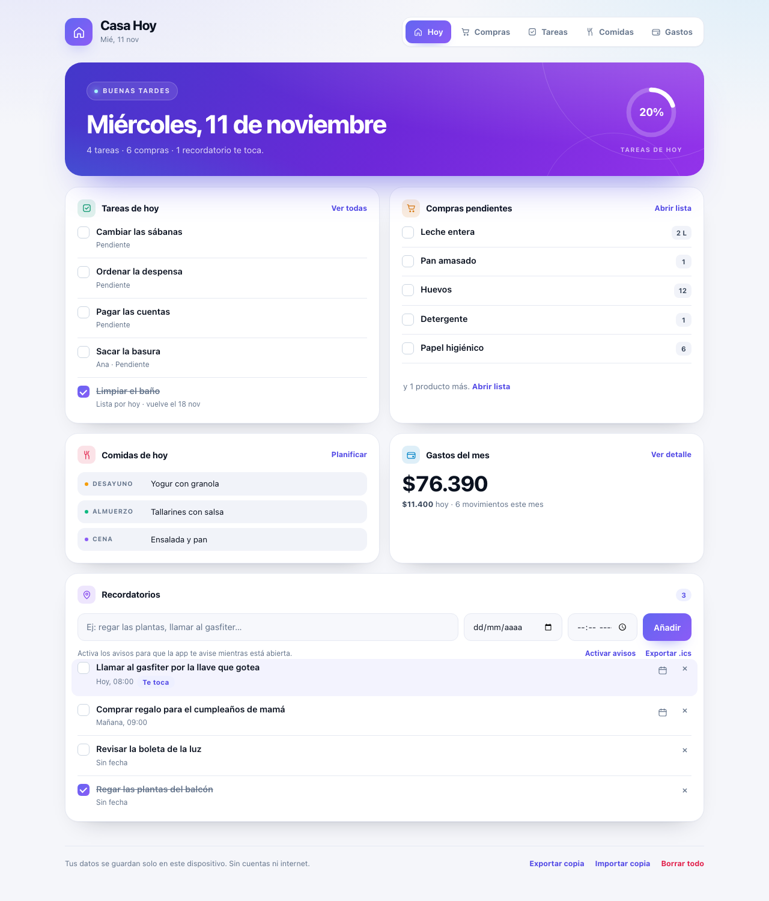

# 🏡 Casa Hoy

Una micro app para el día a día en casa: lista de compras, tareas que se repiten solas, menú semanal, gastos del mes y recordatorios. Todo en una sola pantalla, sin cuentas, sin internet y sin instalar nada.

**App publicada:** https://hpato2010.github.io/casa-hoy/

Repositorio: https://github.com/hpato2010/casa-hoy



*Vista de Hoy con datos de ejemplo.*

## Cómo abrirla

**Opción recomendada (macOS):** haz doble clic en `iniciar.command`. Se abre el navegador en `http://127.0.0.1:8765/` (o el siguiente puerto libre) y la app queda servida localmente. Deja esa ventana de Terminal abierta mientras la usas; ciérrala o pulsa `Ctrl+C` para detener.

**Opción directa:** abre `index.html` con Chrome o Firefox. Funciona sin servidor, pero algunos navegadores (Safari, por ejemplo) no permiten guardar datos en archivos locales. Si eso pasa, usa `iniciar.command`.

No necesita conexión a internet. Los datos quedan en el almacenamiento local del navegador de este dispositivo.

## Verla en el celular

### Versión publicada (recomendada, con HTTPS e instalable)

Abre **https://hpato2010.github.io/casa-hoy/** en el celular y añádela a la pantalla de inicio:
- **iPhone (Safari):** Compartir → **Añadir a pantalla de inicio**.
- **Android (Chrome):** menú ⋮ → **Instalar app** o **Añadir a pantalla de inicio**.

Después de la primera visita funciona sin conexión y sin depender del Mac.

### Misma Wi-Fi (alternativa local, sin publicar nada)

1. Haz doble clic en `servir-en-red.command`. La ventana mostrará una dirección como `http://192.168.1.7:8765/`.
2. Conecta el celular a la misma red Wi-Fi y abre esa dirección en Safari (iPhone) o Chrome (Android).
3. Para dejarla a mano:
   - **iPhone:** Safari → botón Compartir → **Añadir a pantalla de inicio**.
   - **Android:** Chrome → menú ⋮ → **Añadir a pantalla de inicio** (o «Instalar app» si el navegador lo ofrece).

Limitaciones de esta opción: el Mac debe estar encendido y en la misma red, y el atajo no funciona sin conexión. Para que funcione de verdad como app instalada y sin internet, publícala con HTTPS (ver abajo).

### Cómo se publica (para futuras actualizaciones)

La app es 100 % estática y ya está publicada con GitHub Pages desde la rama `main`. Para actualizarla basta con subir los cambios a `main`; GitHub Pages reconstruye sola.

Los datos se guardan en cada dispositivo, no en el repositorio. Usa «Exportar copia» / «Importar copia» para pasarlos de un dispositivo a otro.

## Qué puedes hacer

- **Hoy** — resumen del día: tareas pendientes, compras, comidas y total gastado del mes. El anillo muestra el avance de las tareas de hoy.
- **Compras** — lista agrupada por categoría, con cantidades. Marca lo comprado y limpia la lista con un clic.
- **Tareas** — se repiten según su frecuencia (diaria, semanal, mensual o una sola vez). Al marcarlas, calculan solas cuándo vuelven y avisan si están atrasadas.
- **Comidas** — menú semanal de desayuno, almuerzo y cena. Se repite cada semana y el día de hoy queda resaltado.
- **Gastos** — registro rápido en pesos chilenos, total del mes y desglose por categoría. Puedes navegar entre meses.
- **Recordatorios** — notas rápidas o con fecha y hora. Si tienen fecha, puedes marcarlas como hechas, la app avisa cuando toca y puedes exportarlas a tu calendario.
- **Copias de seguridad** — exporta todo a un archivo `.json` e impórtalo cuando quieras (por ejemplo, al cambiar de navegador).

## Recordatorios y avisos

- Al crear un recordatorio puedes poner **fecha y hora** (si omites la hora, se usa 09:00).
- Cuando llega el momento, la app muestra el recordatorio como **«Te toca»** y lanza un aviso.
- El botón **«Activar avisos»** pide permiso al navegador para mostrar notificaciones. Estos avisos funcionan **mientras la app esté abierta** (o instalada y en segundo plano mientras el navegador la mantenga activa); no hay notificaciones push con la app cerrada.
- Para que el teléfono te avise **aunque la app esté cerrada**, usa **«Exportar .ics»** (o el icono de calendario de cada recordatorio): descarga un archivo que puedes abrir en Google Calendar, Apple Calendario u otra app, y esa app se encarga de la alarma.
- En iPhone, las notificaciones del navegador requieren tener la app instalada en la pantalla de inicio (iOS 16.4 o superior). El calendario es la opción más confiable en móvil.

## Detalles útiles

- Cada sección tiene su propio enlace directo: `index.html#compras`, `#tareas`, `#comidas`, `#gastos`.
- Los montos se escriben como en Chile: `12.500` o `12500`.
- La app parte con cuatro tareas de ejemplo; puedes editarlas o borrarlas. El botón «Borrar todo» deja la app como nueva (sin ejemplos).
- Funciona en modo claro y oscuro según el sistema, y se adapta a celular.

## Estructura

```
casa-hoy/
├── index.html         · estructura de la app
├── styles.css         · diseño responsive y modo oscuro
├── logic.js           · fechas, recurrencias y formato (sin DOM)
├── app.js             · interfaz, eventos y guardado local
├── test-logic.js      · pruebas de la lógica (Node)
├── iniciar.command    · lanzador local para macOS
├── servir-en-red.command · lanzador para verla desde el celular en la misma Wi-Fi
├── manifest.webmanifest · datos de app instalable (PWA)
├── sw.js              · caché para funcionar sin conexión
├── icons/             · iconos de la app
└── capturas/          · vistas de referencia
```

## Pruebas

La lógica de fechas y recurrencias tiene pruebas automáticas:

```bash
node test-logic.js
```

## Privacidad

Nada sale de tu computador: no hay analítica, ni cuentas, ni peticiones a servidores. Todo se guarda con `localStorage` en tu navegador. Si borras los datos del navegador, se pierde la información; por eso conviene exportar una copia de vez en cuando.
